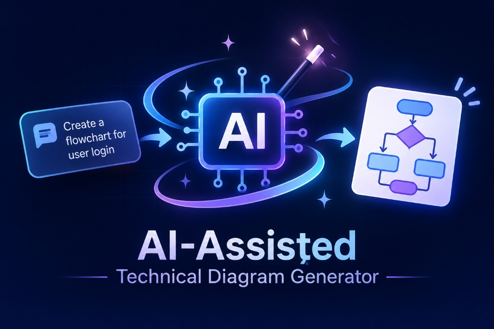

<div align="center">



<br/>
<br/>

# GraphTech — DiagramGPT

> **AI-Powered Technical Diagram Generation & Collaborative Architecture Studio**

[](https://fastapi.tiangolo.com/)
[](https://react.dev/)
[](https://github.com/pgvector/pgvector)
[](https://www.voyageai.com/)
[](https://groq.com/)
[](https://docs.docker.com/compose/)
[](LICENSE)

</div>

---

## 🌟 Overview

**GraphTech (DiagramGPT)** transforms natural language architecture requirements into validated, high-fidelity technical diagrams — Cloud VPC, Microservices, ERDs, CI/CD pipelines, Kubernetes clusters, State Machines, and more — directly from a conversational prompt.

Built as a **monorepo** with a **Vite + React 19** frontend and a **FastAPI + PostgreSQL (pgvector) + Alembic** backend, GraphTech features a **reuse-first AI pipeline**: every prompt is embedded with Voyage AI and searched against previously generated diagrams before invoking an LLM — keeping generation costs near-zero for common requests and delivering sub-second responses on cache hits.

---

## ✨ Features (Through Sprint 6 — Complete)

### 1. 🧠 AI Diagram Generation
- Describe any architecture in plain English and receive a fully rendered, production-quality SVG diagram.
- Supports **Cloud VPC**, **Microservices**, **ERD**, **CI/CD**, **Kubernetes**, **State Machines**, **Network diagrams**, and more.
- Groq LLM generates a **structured JSON AST** that is independently validated with Pydantic before any rendering occurs.

### 2. ⚡ Reuse-First Vector Pipeline
- Every prompt is embedded with **Voyage AI** (1024-dim) and similarity-searched via **pgvector HNSW** before triggering LLM generation.
- **Cache hit** (cosine similarity ≥ threshold): re-validate cached AST and return instantly — no LLM call, near-zero cost.
- **Cache miss**: invoke Groq, generate, validate, render, and persist the new diagram + embedding for future reuse.

### 3. 🎨 Multi-Renderer Support via Kroki
- Deterministic **DSL compilers** for Mermaid, PlantUML, Graphviz DOT, BlockDiag, NwDiag, and ERD.
- All diagrams are compiled and rendered to SVG via the **Kroki** engine.
- Heuristic **renderer detector** automatically picks the optimal compiler for each diagram type.

### 4. 🔧 Automated Output Validation & Auto-Repair
- **SVG XML validation** ensures every rendered output is well-formed.
- **Kroki error interception** detects silent renderer failures.
- **Semantic AST-to-SVG node label reconciliation** catches label drift between generated spec and rendered output.
- **Bounded 2-pass auto-repair loop** automatically corrects malformed DSL before surfacing an error to the user.

### 5. 🔴 Real-Time Async Generation with Stage Progress
- `/api/diagrams/generate-async` initiates a background job with real-time **stage polling**.
- Frontend Studio shows a live progress stepper: *Embedding → Similarity Search → LLM Generation → Compilation → Rendering → Done*.
- Persistent **diagram history** (CRUD) and **diagram-aware conversational Q&A** via `/api/chat/message`.

### 6. 🔐 Security Hardening & Rate Limiting
- **Prompt injection detection & sanitization** neutralizes adversarial directive injections.
- **Scope guard & CS/IT classifier** rejects off-topic prompts before any AI call is made.
- **Sliding-window rate limiter** per client on generation endpoints.
- **Request deduplication** collapses identical concurrent requests.
- **Security audit log** at `/api/diagrams/security-audits` for observability.

### 7. 🔑 Google OAuth 2.0 Authentication
- One-click **Google OAuth 2.0** login with HTTP-only JWT session cookies.
- Full user profile, session management, and per-user diagram history isolation.

---

## 🏗️ Architecture

```text
User Prompt / Reference File Upload
         │
         ▼
┌────────────────────────────────────────────────────────┐
│ Security & Scope Guard (Sprint 6 ✅)                    │
│  1. Prompt injection & directive sanitization          │
│  2. Scope guard (CS/IT diagram classifier)             │
│  3. Sliding-window rate limiter & deduplication        │
└───────────────────────────┬────────────────────────────┘
                            │
                            ▼
┌────────────────────────────────────────────────────────┐
│ Vector Embedding & Similarity Search (Sprint 1 ✅)     │
│  1. spaCy NLP preprocessing (optional)                 │
│  2. Voyage AI → 1024-dim embedding                     │
│  3. pgvector HNSW cosine similarity search             │
└───────────────────────────┬────────────────────────────┘
                            │
                   score ≥ threshold?
                            │
             ┌──────────────┴──────────────┐
             │ YES — Cache Hit             │ NO — Cache Miss
             ▼                             ▼
        Re-validate cached AST        Groq LLM Generation (Sprint 2 ✅)
        Return instantly              Structured JSON AST + Pydantic validation
             │                        Graph complexity scoring & gating
             └──────────────┬──────────────┘
                            │
                            ▼
┌────────────────────────────────────────────────────────┐
│ Renderer Selection & DSL Compilers (Sprint 3 ✅)       │
│  Mermaid · PlantUML · Graphviz DOT · NwDiag · ERD      │
│  Deterministic compilation → Kroki rendering engine    │
└───────────────────────────┬────────────────────────────┘
                            │
                            ▼
┌────────────────────────────────────────────────────────┐
│ Output Validation & Auto-Repair Loop (Sprint 4 ✅)     │
│  1. SVG XML validation & Kroki error filter            │
│  2. Semantic node label reconciliation                 │
│  3. Bounded 2-pass auto-repair loop                    │
└───────────────────────────┬────────────────────────────┘
                            │
                            ▼
┌────────────────────────────────────────────────────────┐
│ Presentation & Persistence (Sprint 5 ✅)               │
│  1. Real-time stage progress polling                   │
│  2. Interactive Studio canvas (SVG preview + DSL code) │
│  3. Persistent history CRUD & Diagram-Aware Chat Q&A   │
└────────────────────────────────────────────────────────┘
```

---

## 🚀 Sprint Progress

| Sprint | Status | Focus |
| :--- | :---: | :--- |
| **Sprint 0** — Foundations | ✅ **Done** | FastAPI skeleton, Google OAuth 2.0, PostgreSQL + pgvector, session handling, Alembic migrations |
| **Sprint 1** — Embeddings & Similarity Search | ✅ **Done** | Voyage AI embeddings (1024-dim), pgvector HNSW index, `/api/diagrams/prepare`, spaCy preprocessing, DB seed |
| **Sprint 2** — Groq Generation & Validation | ✅ **Done** | Groq structured JSON generation, independent Pydantic AST validation, graph complexity scoring & ceiling gating |
| **Sprint 3** — Renderer Selection & Kroki | ✅ **Done** | Deterministic compilers (Mermaid, PlantUML, Graphviz DOT, BlockDiag, NwDiag, ERD), Kroki rendering engine, SVG/DSL persistence |
| **Sprint 4** — Output Validation & Auto-Repair | ✅ **Done** | SVG XML verification, Kroki error interception, semantic AST-to-SVG node label reconciliation, 2-pass bounded auto-repair loop |
| **Sprint 5** — Frontend Wiring & History | ✅ **Done** | Real-time stage progress polling (`/generate-async`), persistent history CRUD (`/api/history`), diagram-aware chat Q&A (`/api/chat/message`), file context extraction |
| **Sprint 6** — Security Hardening & Concurrency | ✅ **Done** | Prompt injection sanitization, scope guard, sliding-window rate limiting, request deduplication, security audit logging (`/api/diagrams/security-audits`) |

---

## 🛠️ Tech Stack

| Layer | Technology |
| :--- | :--- |
| **Frontend** | React 19 · TypeScript · Vite · Three.js (3D background) |
| **Backend** | FastAPI · SQLAlchemy 2.0 (Async) · Pydantic · Alembic |
| **Auth** | Google OAuth 2.0 · HTTP-only JWT session cookies |
| **AI / LLM** | Groq (Qwen 3 · 27B) — structured JSON AST generation |
| **Embeddings** | Voyage AI (`voyage-3-large`, 1024-dim) |
| **Vector DB** | PostgreSQL 16 + pgvector (HNSW cosine indexing) |
| **NLP** | spaCy (`en_core_web_sm`) — optional prompt preprocessing |
| **Rendering** | Kroki Engine · Mermaid · PlantUML · Graphviz DOT · BlockDiag · NwDiag |
| **Deployment** | Docker Compose · GitHub Actions CI |

---

## 📁 Project Structure

```text
GraphTech_V1-main/
├── assets/
│   └── banner.jpg                     # Project banner image
├── frontend/                          # Vite + React 19 SPA
│   ├── public/
│   │   ├── favicon.svg
│   │   └── bg-clean.png
│   └── src/
│       ├── api/
│       │   └── client.js              # Backend API client
│       ├── components/
│       │   ├── Auth/                  # Google OAuth modal
│       │   ├── Background/            # Animated background
│       │   ├── Background3D/          # Three.js 3D background
│       │   ├── Chat/                  # Chat panel + message bubbles + attachments
│       │   ├── Diagram/               # SVG diagram viewer
│       │   ├── Home/                  # Discover / welcome page
│       │   ├── Modal/                 # Reusable modal components
│       │   ├── Navbar/                # Top navigation bar
│       │   ├── Pipeline/              # Generation pipeline stepper UI
│       │   ├── Sidebar/               # History sidebar (CRUD operations)
│       │   └── Studio/                # Dual-pane studio (Canvas + Code viewer + Stepper)
│       ├── App.jsx
│       └── main.jsx
│
├── backend/                           # FastAPI + SQLAlchemy + pgvector
│   ├── alembic/
│   │   └── versions/
│   │       ├── 0001_initial_schema.py     # users + diagram_requests tables
│   │       ├── 0002_add_google_id.py      # google_id column on users
│   │       ├── 0003_vector_index.py       # HNSW index on embedding column
│   │       └── 0004_sprint2_diagram_columns.py  # Sprint 2 extended columns
│   ├── app/
│   │   ├── api/
│   │   │   ├── auth.py                # Google OAuth 2.0 flow & session handling
│   │   │   ├── chat.py                # Diagram-aware conversational Q&A
│   │   │   ├── diagrams.py            # /prepare, /generate, /render, /generate-async, status
│   │   │   ├── health.py              # Health check endpoints
│   │   │   ├── history.py             # Diagram history CRUD endpoints
│   │   │   ├── me.py                  # User profile endpoint
│   │   │   └── router.py              # Central API router aggregator
│   │   ├── core/
│   │   │   ├── config.py              # Settings, rate limits & feature flags
│   │   │   ├── database.py            # SQLAlchemy async session factory
│   │   │   ├── logging.py             # Structured logging setup
│   │   │   ├── rate_limiter.py        # Sliding-window in-memory rate limiter
│   │   │   └── security.py            # JWT creation & token validation
│   │   ├── models/
│   │   │   ├── users.py               # User authentication ORM model
│   │   │   └── diagram_requests.py    # Diagram model with Vector(1024)
│   │   ├── schemas/
│   │   │   ├── diagrams.py            # Pydantic schemas (Prepare, Generate, Render)
│   │   │   ├── health.py              # Health schema
│   │   │   └── users.py               # User schema
│   │   ├── services/
│   │   │   ├── audit_service.py           # Security audit event logger
│   │   │   ├── auth_service.py            # Google OAuth verification service
│   │   │   ├── complexity_service.py      # Graph complexity scoring & ceiling gating
│   │   │   ├── embedding_service.py       # Voyage AI client & pgvector similarity search
│   │   │   ├── generation_service.py      # Pipeline coordinator & auto-repair loop
│   │   │   ├── groq_service.py            # Groq LLM structured JSON generation
│   │   │   ├── job_tracker_service.py     # Async job progress & stage tracker
│   │   │   ├── kroki_client.py            # Kroki engine HTTP client
│   │   │   ├── output_validator_service.py # SVG XML validation & semantic reconciliation
│   │   │   ├── preprocessing_service.py   # spaCy NLP prompt normalizer
│   │   │   ├── renderer_detector.py       # Heuristic compiler/renderer selector
│   │   │   ├── rendering_service.py       # Multi-compiler Kroki rendering coordinator
│   │   │   ├── sanitization_service.py    # Prompt injection detection & sanitization
│   │   │   ├── scope_guard.py             # Technical scope guard & CS/IT classifier
│   │   │   ├── validation_service.py      # Pydantic graph AST validation
│   │   │   └── compilers/                 # Deterministic DSL compilers (Mermaid, PlantUML, DOT)
│   │   └── main.py
│   ├── scripts/
│   │   └── seed_diagrams.py               # Seed script: real diagrams + Voyage embeddings
│   ├── tests/
│   │   ├── conftest.py                    # Test fixtures & SQLite fallback
│   │   ├── test_auth_flow.py              # Sprint 0: OAuth & session tests
│   │   ├── test_db.py                     # Sprint 0: Database schema & constraints
│   │   ├── test_embedding_service.py      # Sprint 1: Voyage AI client tests
│   │   ├── test_prepare_endpoint.py       # Sprint 1: /prepare pipeline tests
│   │   ├── test_similarity_search.py      # Sprint 1: pgvector cosine search tests
│   │   ├── test_sprint2_complexity.py     # Sprint 2: Complexity scoring tests
│   │   ├── test_sprint2_validation.py     # Sprint 2: Pydantic AST validation tests
│   │   ├── test_sprint2_generate.py       # Sprint 2: /generate endpoint tests
│   │   ├── test_sprint3_rendering.py      # Sprint 3: Compiler & Kroki rendering tests
│   │   ├── test_sprint4_autorepair.py     # Sprint 4: 2-pass auto-repair loop tests
│   │   ├── test_sprint4_output_validation.py # Sprint 4: SVG output validation tests
│   │   ├── test_sprint5_frontend_wiring.py   # Sprint 5: Async jobs, history, chat tests
│   │   └── test_sprint6_security.py          # Sprint 6: Rate limits, injection, audits
│   ├── requirements.txt
│   ├── .env.example
│   └── Dockerfile
│
├── docker-compose.yml
├── Complete_Implementation_Plan.md
└── README.md
```

---

## 🚦 How to Run Locally

### Prerequisites

- **Python** 3.11 or 3.12
- **Node.js** 18+ and npm
- **PostgreSQL** 14+ with the **pgvector** extension installed
- A **Voyage AI** API key — [dash.voyageai.com](https://dash.voyageai.com/)
- A **Groq** API key — [console.groq.com](https://console.groq.com/)
- A **Google OAuth** Client ID & Secret — [Google Cloud Console](https://console.cloud.google.com/)

---

### Option A — Docker Compose (Recommended)

Spin up PostgreSQL/pgvector + the FastAPI backend in one command:

```bash
docker compose up -d
```

| Service | URL |
| :--- | :--- |
| Backend API | http://localhost:8000 |
| Swagger Docs | http://localhost:8000/docs |
| Health Check | http://localhost:8000/health |

Then start the frontend separately (see Option B, Step 3).

---

### Option B — Manual Local Development

#### 1. Clone & Configure

```bash
git clone <repo-url>
cd GraphTech_V1-main
```

#### 2. Backend Setup

```bash
cd backend

# Create and activate virtual environment
python -m venv .venv
.venv\Scripts\activate        # Windows
# source .venv/bin/activate   # macOS / Linux

# Install dependencies
pip install -r requirements.txt

# Download optional spaCy NLP model
python -m spacy download en_core_web_sm

# Configure environment variables
cp .env.example .env
# → Edit .env with your DATABASE_URL, GOOGLE_CLIENT_ID, GOOGLE_CLIENT_SECRET,
#   VOYAGE_API_KEY, GROQ_API_KEY

# Apply all Alembic migrations (creates tables + HNSW vector index)
alembic upgrade head

# Seed the DB with 8 real diagram examples + Voyage embeddings
python scripts/seed_diagrams.py

# Start the FastAPI backend
uvicorn app.main:app --reload --host 0.0.0.0 --port 8000
```

| Endpoint | URL |
| :--- | :--- |
| Health check | http://localhost:8000/health |
| Swagger UI | http://localhost:8000/docs |
| ReDoc | http://localhost:8000/redoc |

#### 3. Frontend Setup

```bash
cd frontend
npm install
npm run dev
```

**Frontend:** http://localhost:5173

---

## ⚙️ Environment Variables

### Backend (`backend/.env`)

| Variable | Required | Description | Default |
| :--- | :---: | :--- | :--- |
| `DATABASE_URL` | ✅ | PostgreSQL connection string with pgvector | — |
| `GOOGLE_CLIENT_ID` | ✅ | Google OAuth Client ID | — |
| `GOOGLE_CLIENT_SECRET` | ✅ | Google OAuth Client Secret | — |
| `SESSION_SECRET` | ✅ | Random JWT signing secret | — |
| `VOYAGE_API_KEY` | ✅ | Voyage AI key for 1024-dim embeddings | — |
| `GROQ_API_KEY` | ✅ | Groq LLM key for fast JSON generation | — |
| `VOYAGE_MODEL` | — | Embedding model | `voyage-3-large` |
| `SIMILARITY_THRESHOLD` | — | Cosine similarity cutoff for diagram reuse | `0.75` |
| `SIMILARITY_TOP_K` | — | Max candidate diagrams retrieved | `5` |
| `GROQ_MODEL` | — | Primary LLM model | `qwen/qwen3-27b` |
| `COMPLEXITY_CEILING` | — | Complexity rejection ceiling | `50.0` |
| `KROKI_BASE_URL` | — | Kroki rendering engine URL | `https://kroki.io` |
| `ENABLE_SPACY_PREPROCESSING` | — | Toggle spaCy NLP normalizer | `false` |
| `RATE_LIMIT_ENABLED` | — | Sliding-window API rate limiter | `true` |
| `RATE_LIMIT_DIAGRAM_PER_MINUTE` | — | Generation requests per minute per client | `15` |
| `ENABLE_PROMPT_SANITIZATION` | — | Neutralize adversarial prompt injections | `true` |
| `DEDUPLICATION_WINDOW_SECONDS` | — | Seconds to collapse identical requests | `30` |
| `CORS_ORIGINS` | — | Allowed frontend origins | `["http://localhost:5173"]` |

### Frontend (`frontend/.env`)

| Variable | Description | Default |
| :--- | :--- | :--- |
| `VITE_API_BASE_URL` | FastAPI backend base URL | `http://localhost:8000` |
| `VITE_GOOGLE_CLIENT_ID` | Google OAuth Client ID | — |

---

## 🗄️ Database

PostgreSQL 16 with the `pgvector` extension.

### Tables

| Table | Purpose |
| :--- | :--- |
| `users` | Authenticated users (Google OAuth) — `id`, `email`, `name`, `avatar_url`, `google_id` |
| `diagram_requests` | Diagram history — `prompt`, `embedding` (Vector 1024), `structured_json` (JSONB), `complexity`, `renderer`, `status`, `output_path`, `chat_history` |

### Indexes

| Index | Type | Column | Purpose |
| :--- | :--- | :--- | :--- |
| `diagram_requests_pkey` | B-tree | `id` | Primary key |
| `ix_diagram_requests_user_id` | B-tree | `user_id` | Filter by user |
| `idx_diagram_requests_embedding_hnsw` | **HNSW** | `embedding` | Sub-10 ms cosine similarity search |

---

## 🔌 API Reference

All endpoints across Sprints 0 through 6 are fully implemented and verified.

| Method | Path | Sprint | Description |
| :--- | :--- | :---: | :--- |
| `GET` | `/health` | 0 | Service liveness check |
| `GET` | `/api/health` | 0 | API health check |
| `GET` | `/api/auth/google/login` | 0 | Redirect to Google OAuth consent screen |
| `GET` | `/api/auth/google/callback` | 0 | OAuth callback, sets HTTP-only JWT cookie |
| `GET` | `/api/auth/session` | 0 | Returns active user session |
| `POST` | `/api/auth/logout` | 0 | Clears session cookie |
| `GET` | `/api/me` | 0 | Authenticated user profile |
| `POST` | `/api/diagrams/prepare` | 1 | Dev: preprocess → embed → similarity search |
| `POST` | `/api/diagrams/generate` | 2 | Synchronous full pipeline (reuse or Groq LLM) |
| `POST` | `/api/diagrams/render` | 3 | On-demand DSL compilation & Kroki SVG rendering |
| `POST` | `/api/diagrams/generate-async` | 5 | Async generation job initiation |
| `GET` | `/api/diagrams/{job_id}/status` | 5 | Real-time stage progress polling |
| `POST` | `/api/diagrams/upload-reference` | 5 | Context file upload & prompt sanitization |
| `GET` | `/api/history` | 5 | List user diagram generation history |
| `GET` | `/api/history/{id}` | 5 | Get single diagram details (SVG + AST) |
| `DELETE` | `/api/history/{id}` | 5 | Delete diagram from history |
| `PUT` | `/api/history/{id}/chat` | 5 | Update session chat history |
| `POST` | `/api/chat/message` | 5 | Diagram-aware conversational Q&A |
| `GET` | `/api/diagrams/security-audits` | 6 | Security audit event log (rate limits, injections) |

---

## 🧪 Running Tests

```bash
cd backend

# Run the full test suite across all 6 sprints
pytest tests/ -v
```

**110+ passing tests across Sprints 0 through 6.**

| Test File | Sprint | Verified Functionality |
| :--- | :---: | :--- |
| `test_auth_flow.py` | 0 | Google OAuth flow, JWT verification, session cookies |
| `test_db.py` | 0 | PostgreSQL schema, Alembic migration state, foreign keys |
| `test_embedding_service.py` | 1 | Voyage AI client, retries, timeout handling |
| `test_prepare_endpoint.py` | 1 | `/api/diagrams/prepare` pipeline, spaCy toggling |
| `test_similarity_search.py` | 1 | pgvector cosine similarity ranking & thresholds |
| `test_sprint2_complexity.py` | 2 | Graph complexity calculation, ceiling gating |
| `test_sprint2_validation.py` | 2 | Pydantic AST schema validation, malformed payload detection |
| `test_sprint2_generate.py` | 2 | `/api/diagrams/generate` reuse vs LLM generation |
| `test_sprint3_rendering.py` | 3 | Compilers (Mermaid, PlantUML, DOT), Kroki rendering client |
| `test_sprint4_autorepair.py` | 4 | 2-pass auto-repair loop, retry budget exhaustion |
| `test_sprint4_output_validation.py` | 4 | SVG XML validation, Kroki error text filter, label reconciliation |
| `test_sprint5_frontend_wiring.py` | 5 | Async job tracking, status polling, history CRUD, chat Q&A |
| `test_sprint6_security.py` | 6 | Prompt sanitization, rate limiting, deduplication, audit logs |

---

## 🔑 Getting API Keys

### Voyage AI — Embeddings (Sprint 1)
1. Go to [dash.voyageai.com](https://dash.voyageai.com/)
2. Sign up with Google or GitHub (one click — no credit card required)
3. Navigate to **API Keys** → **Create new secret key**
4. Copy the key (`pa-xxxxxxxx`) into `backend/.env` as `VOYAGE_API_KEY`
5. **Free tier:** 200 million tokens

### Groq — LLM Generation (Sprint 2)
1. Go to [console.groq.com](https://console.groq.com/)
2. Sign up and navigate to **API Keys** → **Create API Key**
3. Copy the key into `backend/.env` as `GROQ_API_KEY`
4. **Free tier** available

### Google OAuth — Authentication (Sprint 0)
1. Go to [Google Cloud Console](https://console.cloud.google.com/) → **APIs & Services** → **Credentials**
2. Create an **OAuth 2.0 Client ID** (Web application)
3. Add `http://localhost:8000/api/auth/google/callback` to **Authorized Redirect URIs**
4. Copy the Client ID and Secret into `backend/.env`

---

## © Copyright 2026

Copyright © 2026 Shlok Kondekar and Project Team.

All rights reserved.

This project and its original source code are the intellectual property of the project authors. Unauthorized copying, modification, redistribution, or commercial use is prohibited without prior written permission.

---

<div align="center">

Made with ❤️ by **Shlok Kondekar** and the **GraphTech Project Team**

</div>
